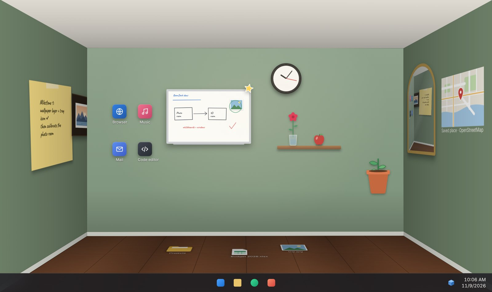

# RoomDesk

Your Windows desktop as a 3D room. An open-source BumpTop replacement, built with Tauri.



*Design preview. Early development.*

## Run

```powershell
git clone https://github.com/binodil/RoomDesk.git
cd RoomDesk
npm install
npm run tauri dev
```

First time? See [docs/SETUP.md](docs/SETUP.md).

MIT License
