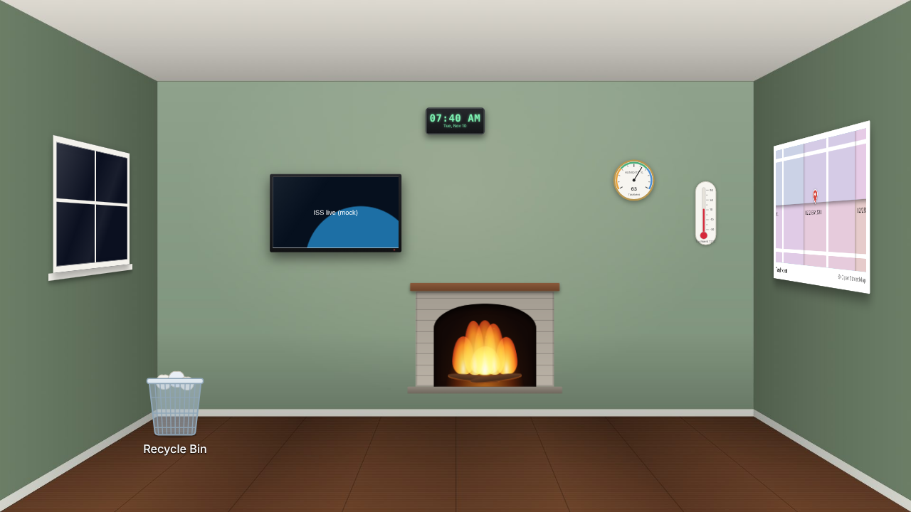

# RoomDesk

Your Windows desktop as a room. An open-source take on BumpTop, built with [Tauri](https://tauri.app).



Use a photo of your own room (or the sample room), mark its corners once, and RoomDesk draws everything in the room's perspective, behind your desktop icons, on every monitor.

## Download

Get the installer from [Releases](https://github.com/binodil/RoomDesk/releases): run `RoomDesk_…_x64-setup.exe`. No administrator rights are needed. Windows 10 and 11.

After it starts, look for the cube icon in the taskbar tray (bottom right, possibly behind the **^** arrow). Everything is in its menu.

## What you can put in the room

- **Your files**: shortcuts, programs, folders and documents with their real icons. Click to open.
- **Notes and whiteboards**: click to zoom in, then type, draw and stick pictures.
- **TV**: the space station live stream (or any YouTube link) with sound.
- **Window**: your own picture of a view, with ocean, wind or rain sounds.
- **Fireplace** with a crackling fire, **clock** (analog or digital), **map**, **thermometer** and **humidity** dial for your city.
- **Things that live**: a plant that grows and needs watering, a rose that blooms and wilts over two weeks, an apple that browns in a week.
- **Mirror**, **pictures**, **stickers** and a **Recycle Bin**.

Tray → **Edit items…** to add, move (drag), resize (scroll) and remove things. Tray → **Calibrate room…** to fit the walls to your photo.

RoomDesk pauses its videos, sounds and animations while a game or other full-screen app is open.

## Privacy

RoomDesk has no account and sends no usage data. Some items fetch from free public services: map tiles from [OpenStreetMap](https://www.openstreetmap.org/copyright), weather and place search from [Open-Meteo](https://open-meteo.com), and videos from YouTube. Settings are kept in `%APPDATA%\RoomDesk`.

## Build it yourself

```powershell
git clone https://github.com/binodil/RoomDesk.git
cd RoomDesk
npm install
npm run tauri dev      # run it
npm run tauri build    # make the installer
```

First time building? See [docs/SETUP.md](docs/SETUP.md). On a Mac (early test version), see [docs/SETUP-mac.md](docs/SETUP-mac.md). To publish a release, push a tag like `v1.0.0`: GitHub builds the installer and makes a draft release.

## License

MIT. Map data © OpenStreetMap contributors.
